# Manu Upadhyaya Website

Source for <https://manuupadhyaya.github.io>.

This repository contains the Jekyll source for Manu Upadhyaya's personal academic website. It started from the [al-folio](https://github.com/alshedivat/al-folio) theme.

## Site Pages

The site exposes:

- `/` About
- `/news/`
- `/publications/`
- `/software/`
- `/teaching/`
- `/blog/`
- `/share/CV.pdf`

The template-only posts, projects, repositories, people, and demo media content are intentionally not part of this repo anymore.

## Main Content Files

- `_pages/about.md`: homepage content
- `_news/`: homepage and `/news/` announcements
- `_pages/publications.md` and `_bibliography/papers.bib`: publication list
- `_pages/software.md`: software/projects summary page
- `_pages/teaching.md`: teaching page
- `_pages/blog.md`: blog landing page
- `_posts/`: blog posts
- `_data/`: structured metadata such as socials, venues, and coauthors
- `share/`: PDFs linked directly from the site
- `assets/img/prof_pic.jpg`: profile photo
- `assets/img/prof_pic_color.png`: Open Graph preview image

## Local Development

### Ruby/Bundler

```bash
bundle install
pip install -r requirements.txt
bundle exec jekyll serve --unpublished
```

Open `http://localhost:4000`.

### Docker

For day-to-day previews:

```bash
docker compose up
```

For the first run, or after changing dependencies (`Gemfile` or `Gemfile.lock`), `Dockerfile`, or `bin/entry_point.sh`, use `docker compose up --build`.

Open `http://localhost:8080`.

Development previews cache minified JavaScript in the existing `.jekyll-cache` volume. Unchanged scripts are reused across restarts; edits, compiler options, and dependency changes invalidate the cache. The first build after clearing the cache still performs the initial compilation.

Both local preview methods include unpublished posts.

### Writing Blog Posts

Create posts in `_posts/` using a filename such as `YYYY-MM-DD-post-title.md` and the `post` layout. Set `math: true` for posts that use LaTeX math.

Keep `published: false` in the front matter while writing. Change it to `published: true` when the post is ready to publish. Production builds exclude unpublished posts.

The Lyapunov post uses `_bibliography/lyapunov-blog.bib` for references. Write `\cite{UBTG25}` in the main text to display a linked `[UBTG25]` citation, or `\cite{UBTG25,UDGT26}` for multiple sources. The References section is generated automatically from cited entries. To include sources without citing them in the text, use `\nocite{Tay20,DT26}` before the bibliography. Citation commands inside equations, code examples, and comments remain literal.

Set `citation_url` to the final public post URL so the displayed and copied BibTeX stays correct in local previews.

The Lyapunov post also enables `local_roboto` and `math_cooperative` to reduce font loading movement and long rendering tasks without changing the finished page. The local Roboto files are byte-identical copies of the existing Google Fonts version, with the original four weight mappings and all nine subsets retained; their license and provenance are in `assets/fonts/roboto-v51/`. Keep these mappings intact when updating fonts, since a variable weight range can change which face renders headings or equation labels.

The cooperative helper only batches the initial MathJax compile, enrichment, and typesetting stages between complete expressions. DOM insertion, speech, exploration, and later rendering retain their native behavior. It supports the pinned MathJax 4.1.3 internal API and falls back to ordinary rendering on unsupported versions. Before upgrading MathJax or these fonts, run the rendering tests against the pinned source and compare the finished article on desktop and mobile, including equation labels and display text. CI installs `@mathjax/src@4.1.3` for the full suite; locally set `MATHJAX_SOURCE_DIR` to that package's directory when running `node --test tests/*.test.mjs`.

The article's separate `math_font_preparation` flag fetches its twelve existing NewCM font files at low priority after an initial paint, while MathJax processes the expressions. This avoids repeated page layouts as fonts arrive after rendering; font bytes, CSS, and native MathJax completion remain unchanged. Preparation skips unsupported versions, fonts, and font paths. The file list is specific to this article: check font usage again when changing its content or MathJax version.

### Local Working Files

Keep temporary review reports, screenshots, and ad hoc Lighthouse output in `tmp/` or `output/`. These directories, local environments, and generated caches are ignored by Git. Local review files, contributor instructions, generators, and tests are excluded from the generated website.

Keep blog source, `assets/data/`, `assets/figures/`, `scripts/`, and `tests/` versioned. The existing `lighthouse_results/` reports and badges are maintained by the Lighthouse workflow and remain versioned.

## Deployment

Pushes to `main` trigger the GitHub Actions deployment workflow. GitHub Pages serves the generated site from `gh-pages`.

If you change the site URL or repository name, update `url` and `baseurl` in `_config.yml`.

## Related Automation

- `deploy.yml` builds and deploys the site.
- `prettier.yml` checks formatting for Markdown, Liquid, CSS, JavaScript, JSON, SCSS, and workflow files.
- `broken-links.yml` checks Markdown and HTML source files.
- `broken-links-site.yml` checks the generated `_site` output after deploy.
- `axe.yml` builds the site and runs an accessibility scan on the homepage.
- `codeql.yml` runs CodeQL on JavaScript/TypeScript and Ruby code.
- `lighthouse-badger.yml` runs Lighthouse PageSpeed Insights after a successful deploy or manual dispatch, then writes badges/reports back to the repository.
- `lighthouse-blog.yml` privately checks the blog index and unpublished Lyapunov article on mobile and desktop, without deploying drafts or uploading their HTML reports.
- `docker-compose.yml` and `Dockerfile` support local containerized development.

## Lighthouse PageSpeed Insights

### Desktop

[](https://htmlpreview.github.io/?https://github.com/ManuUpadhyaya/manuupadhyaya.github.io/blob/main/lighthouse_results/desktop/manuupadhyaya_github_io_.html)

Run the test yourself: [Google Lighthouse PageSpeed Insights](https://pagespeed.web.dev/report?url=https%3A%2F%2Fmanuupadhyaya.github.io%2F&form_factor=desktop)

### Mobile

[](https://htmlpreview.github.io/?https://github.com/ManuUpadhyaya/manuupadhyaya.github.io/blob/main/lighthouse_results/mobile/manuupadhyaya_github_io_.html)

Run the test yourself: [Google Lighthouse PageSpeed Insights](https://pagespeed.web.dev/report?url=https%3A%2F%2Fmanuupadhyaya.github.io%2F&form_factor=mobile)

## Upstream Theme

If you want to reintroduce removed al-folio features such as the projects grid, repositories page, or people page, use the upstream theme as the source of truth:

- <https://github.com/alshedivat/al-folio>
